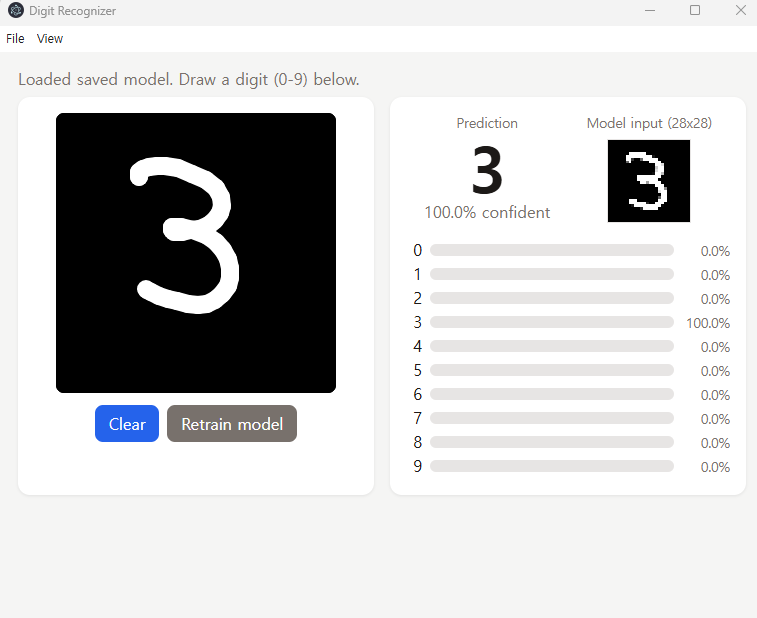
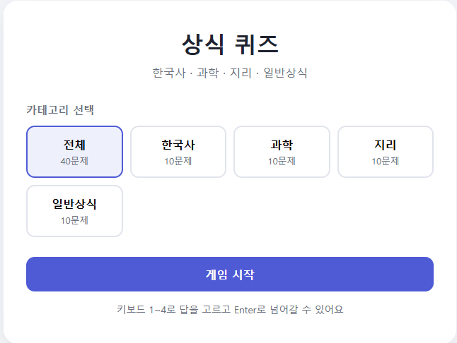
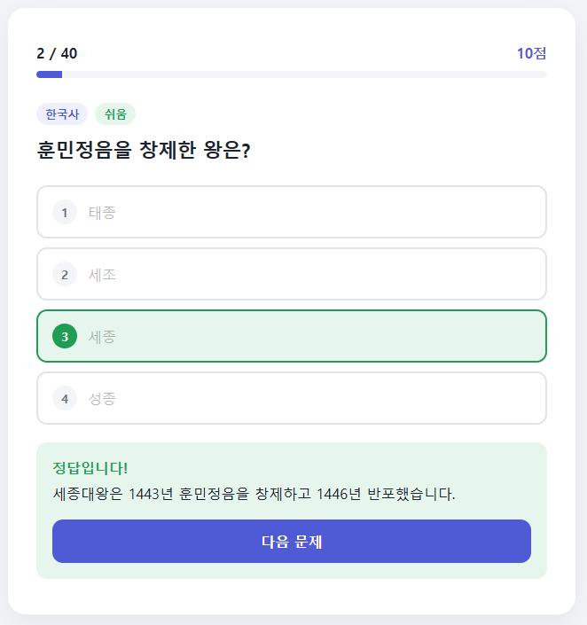
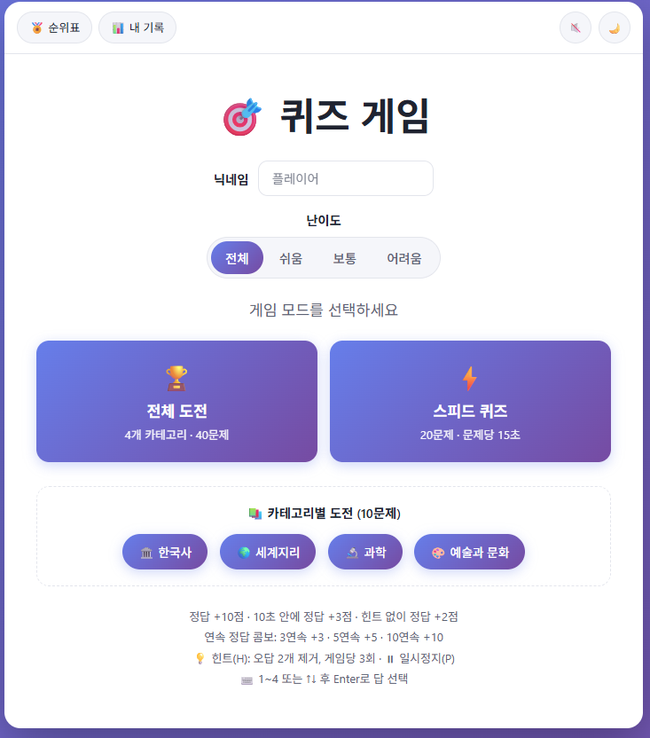
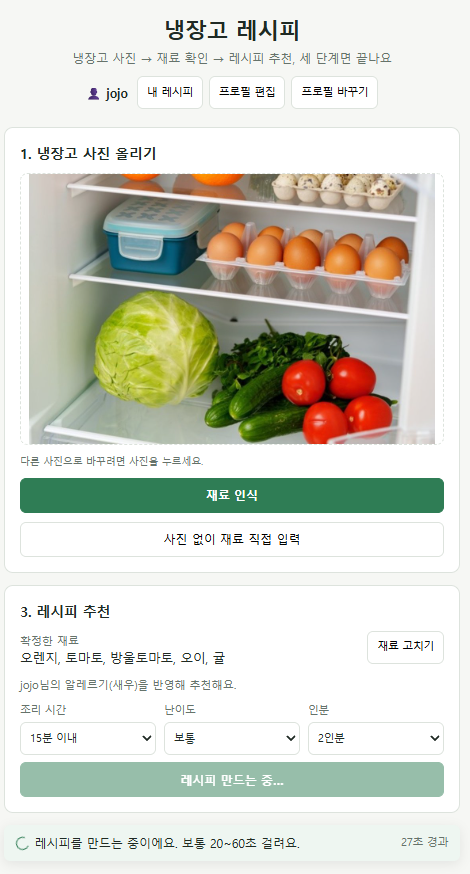
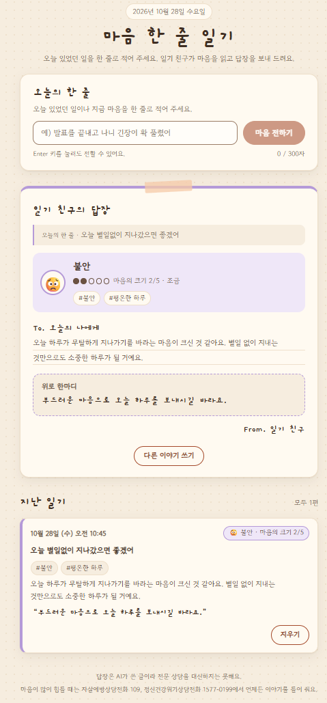

<!-- 작성일시: 2026-10-28 11:10 -->

<div align="center">

# 🚀 VibeCoding 실습 노트

**인프런 바이브 코딩 강의 실습 모음**

Claude Code와 대화하며 **PRD(제품 요구사항 문서)를 먼저 쓰고**, 그 PRD를 바탕으로 앱을 만들어 본 기록입니다.


</div>

---

## 📚 목차

| # | 프로젝트 | 한 줄 소개 | 핵심 기술 |
|:-:|---|---|---|
| 01 | [✍️ 손글씨 숫자 인식기](#-study-01--손글씨-숫자-인식기) | MNIST로 학습한 CNN이 손으로 그린 숫자를 맞힘 | TensorFlow.js · Electron |
| 02 | [✅ 할 일 관리 앱](#-study-02--할-일-관리-앱) | 카테고리·진행률·검색·다크 모드를 갖춘 Todo | HTML · CSS · JS |
| 03 | [🧠 상식 퀴즈 게임 (기본)](#-study-03--상식-퀴즈-게임-기본) | 카테고리를 골라 푸는 4지선다 퀴즈 | HTML · CSS · JS |
| 03+ | [🎯 상식 퀴즈 게임 (고급)](#-study-03-basic--상식-퀴즈-게임-고급) | 난이도·스피드 모드·콤보·순위표까지 | JS · localStorage · 커스텀 명령 |
| 04 | [🥬 냉장고를 부탁해](#-study-04--냉장고를-부탁해-ai-레시피-추천) | 냉장고 사진 → 재료 인식 → AI 레시피 추천 | Express · OpenRouter · sharp |
| 05 | [📔 공감 AI 다이어리](#-study-05--공감-ai-다이어리) | 한 줄 일기의 감정을 분석하고 공감 답장 | Express · OpenRouter |

---

## 🛠️ 공통 작업 방식

```
 💬 아이디어  ──▶  📝 PRD 작성  ──▶  🤖 Claude Code로 구현  ──▶  🧪 테스트·QA  ──▶  🔁 개선
```

- **모든 프로젝트는 Claude Code로 개발**했습니다. 직접 코드를 치기보다 요구사항을 말로 설명하고, 결과를 확인하며 고쳐 나갔습니다.
- 구현 전에 **PRD**로 목표·기능·제약을 정리했습니다. (예: `Study-04/PRD_step1~3.md` 단계별 PRD)
- 프로젝트마다 `CLAUDE.md`로 Claude Code에 작업 규칙(코드는 영어, 주석은 한국어, `.bat`은 CP949 등)을 알려 줬습니다.
- 뒤쪽 프로젝트로 갈수록 **커스텀 슬래시 명령**(Study-03+)과 **서브 에이전트**(Study-04, 05)처럼 Claude Code 기능을 더 많이 활용했습니다.

---

## ✍️ Study-01 · 손글씨 숫자 인식기

> 마우스로 숫자(0–9)를 그리면 **MNIST 데이터셋**으로 학습한 CNN이 어떤 숫자인지 알아맞힙니다.

<p align="center">
  
</p>

**주요 기능**
- 🖌️ 캔버스에 숫자를 그리면 **예측 숫자 + 확신도 + 0–9 확률 막대**를 바로 표시
- 🔍 모델에 실제로 들어간 **28×28 입력 이미지** 미리보기
- 🔄 `Retrain model`로 모델을 처음부터 다시 학습 (테스트 정확도 약 **98.6%**)
- 🖥️ 같은 모델·전처리로 **웹 버전**과 **데스크톱(Electron) 버전** 두 가지 제공

**모델 구조** — `Conv(16) → Pool → Conv(32) → Pool → Dense(128) → Dropout → Softmax(10)`

```bash
# 웹 버전:     web_version\Start Digit Recognizer.bat  (→ http://localhost:3000)
# 데스크톱 버전: desktop_version\Start Digit Recognizer.bat
```

📄 자세한 설명: [`Study-01/README.md`](Study-01/README.md)

---

## ✅ Study-02 · 할 일 관리 앱

> 빌드 도구 없이 **순수 HTML/CSS/JavaScript**로 만든 깔끔한 Todo 앱입니다.

<p align="center">
  
</p>

**주요 기능**
- 🏷️ **업무 · 개인 · 공부** 카테고리 분류와 카테고리별 필터
- 📊 전체·카테고리별 **진행률 막대**, 오늘 추가한 할 일 개수
- 🔎 할 일 **검색**, `Alt+N` 단축키로 빠른 입력
- 🌙 **라이트/다크 모드** 토글
- 💾 `localStorage`에 저장해 새로고침해도 유지

```bash
# Study-02/index.html 을 브라우저로 열면 바로 실행
```

---

## 🧠 Study-03 · 상식 퀴즈 게임 (기본)

> **한국사 · 과학 · 지리 · 일반상식** 4개 카테고리, 총 40문제의 4지선다 퀴즈입니다.

<p align="center">
  
  
</p>

**주요 기능**
- 📂 카테고리 선택 (전체 40문제 / 카테고리별 10문제)
- ⌨️ 키보드 `1~4`로 답 선택, `Enter`로 다음 문제
- 🗂️ 문제 데이터(`js/questions.js`)와 게임 로직(`js/game.js`) 분리

```bash
# Study-03/index.html 을 브라우저로 열면 바로 실행
```

---

## 🎯 Study-03-basic · 상식 퀴즈 게임 (고급)

> 기본 퀴즈를 확장해 **게임 모드·점수 시스템·기록 관리**를 더하고, Claude Code **커스텀 슬래시 명령**으로 문제 관리까지 자동화했습니다.

<p align="center">
  
</p>

**주요 기능**
- 🏆 **전체 도전**(40문제) · ⚡ **스피드 퀴즈**(20문제, 문제당 15초) · 📚 **카테고리별 도전**
- 🎚️ 난이도 선택 (쉬움 · 보통 · 어려움)
- ➕ 점수 시스템: 정답 +10점, 10초 안에 정답 +3점, 힌트 없이 정답 +2점, **연속 정답 콤보** 보너스
- 💡 힌트(오답 2개 제거, 게임당 3회), ⏸️ 일시정지, 🔇 사운드, 🌙 다크 모드
- 🥇 닉네임별 **순위표**와 **내 기록** (`localStorage`)
- ✅ `tests/localDataManager.test.js` 단위 테스트

**🤖 Claude Code 커스텀 명령** (`.claude/commands/`)

| 분류 | 명령 |
|---|---|
| 문제 관리 | `/quiz-add` `/quiz-check` `/quiz-validate` `/quiz-range` `/quiz-daily` |
| 기록·통계 | `/quiz-stats` `/quiz-leaderboard` `/export-report` |
| 교사 모드 | `/teacher-mode` `/teacher-overview` `/teacher-report` `/teacher-weakness` `/teacher-compare` `/teacher-collect` |

> 📌 `CLAUDE.md`에 **문제 교차 검증 가이드라인**(정답이 하나뿐인지, 최상급 표현의 기준, 시점·범위 명시, 2개 이상 출처 확인)을 넣어 Claude가 만드는 문제의 정확도를 높였습니다.

---

## 🥬 Study-04 · 냉장고를 부탁해 (AI 레시피 추천)

> 냉장고 사진을 올리면 **AI가 재료를 인식**하고, 그 재료로 만들 수 있는 **레시피를 추천**합니다.

<p align="center">
  
</p>

**PRD 3단계로 나눠 개발**

| 단계 | PRD | 내용 |
|:-:|---|---|
| 1 | [`PRD_step1.md`](Study-04/PRD_step1.md) | 📷 냉장고 사진 → **재료 인식** (임베딩 + 코사인 유사도) |
| 2 | [`PRD_step2.md`](Study-04/PRD_step2.md) | 🍳 확정한 재료 → **레시피 생성** (조리 시간·난이도·인분 선택) |
| 3 | [`PRD_step3.md`](Study-04/PRD_step3.md) | 👤 **프로필**(알레르기·식단·매운맛)과 **내 레시피 저장** |

**주요 기능**
- 🧾 인식된 재료를 직접 고치거나, 사진 없이 재료만 입력해도 추천
- ⚠️ 프로필의 **알레르기 재료를 반영**하고, 포함되면 경고 표시
- 🔁 무료 모델이 실패하면 **대체 모델로 자동 전환**, 요청 수·시간 예산(`RequestBudget`)으로 무료 한도 보호
- 🎭 `npm run demo` — AI 호출 없이 화면 흐름을 시험하는 **데모 모드**
- 📏 `npm run evaluate` — 평가용 사진 11장으로 인식 정밀도·재현율 측정

**🤖 서브 에이전트** (`.claude/agents/`): `code-reviewer` · `performance-optimizer` · `ux-designer`

```bash
cd Study-04
cp .env.example .env   # OPENROUTER_API_KEY 입력
npm install
npm start              # → http://localhost:3000  (또는 start.bat)
```

---

## 📔 Study-05 · 공감 AI 다이어리

> 오늘 있었던 일을 **한 줄**로 쓰면, AI 일기 친구가 **감정을 분석**하고 **공감과 위로**의 답장을 보내 줍니다.

<p align="center">
  
</p>

**주요 기능**
- 💭 감정 분석: 대표 감정 · **마음의 크기(1~5)** · 감정 키워드
- 💌 "To. 오늘의 나에게" 공감 메시지 + 위로 한마디
- 📖 **지난 일기** 목록 보기·삭제
- 🆘 **위기 표현 감지** — 자해·자살 암시가 보이면 상담 전화(109, 1577-0199) 안내를 띄우고, 위로 문구는 검증된 고정 문장 사용
- 🗣️ 답장 품질 보정: 반말·영어가 섞이면 다시 요청하거나 서버에서 높임말로 고침
- 🔒 보안: 로컬 출처만 허용(DNS 리바인딩·외부 Origin 차단), API 키는 서버에만 보관

**🤖 서브 에이전트로 팀처럼 개발** (`.claude/agents/`)

`product-manager` · `frontend-developer` · `backend-developer` · `ai-integration-engineer` · `qa-engineer`

> 🧪 QA 에이전트가 작성한 [`QA_REPORT.md`](Study-05/QA_REPORT.md)와 12개 테스트 파일로 위기 감지·말투 규칙을 검증했습니다.

```bash
cd Study-05
cp .env.example .env   # OPENROUTER_API_KEY 입력
npm install
npm start              # → http://127.0.0.1:3000  (또는 start.bat)
npm test               # 테스트 실행
```

---

## 🧰 기술 스택 정리

### 프로젝트별 한눈에 보기

| 구분 | 01 숫자 인식 | 02 Todo | 03 퀴즈 | 03+ 퀴즈 고급 | 04 냉장고 | 05 다이어리 |
|---|:-:|:-:|:-:|:-:|:-:|:-:|
| HTML / CSS / JavaScript | ✅ | ✅ | ✅ | ✅ | ✅ | ✅ |
| 빌드 도구 없는 순수 프런트엔드 | ✅ | ✅ | ✅ | ✅ | ✅ | ✅ |
| `localStorage` | | ✅ | | ✅ | ✅ | |
| Node.js | ✅ | | | | ✅ | ✅ |
| Express 5 | | | | | ✅ | ✅ |
| TensorFlow.js (CNN) | ✅ | | | | | |
| Electron (데스크톱) | ✅ | | | | | |
| sharp (이미지 처리) | | | | | ✅ | |
| OpenRouter API (LLM) | | | | | ✅ | ✅ |
| JSON 파일 저장소 | | | | | ✅ | ✅ |
| 테스트 (`node --test` 등) | | | | ✅ | ✅ | ✅ |
| Claude Code 커스텀 명령 | | | | ✅ | | |
| Claude Code 서브 에이전트 | | | | | ✅ | ✅ |

### 분야별 정리

| 분야 | 기술 | 사용한 곳 |
|---|---|---|
| 🎨 **프런트엔드** | HTML5, CSS3, Vanilla JavaScript (ES Modules), Canvas API, Google Fonts | 전체 |
| ⚙️ **백엔드** | Node.js 24, Express 5 | 01(웹), 04, 05 |
| 🧠 **머신러닝** | TensorFlow.js 4.22 — MNIST CNN 학습·추론 | 01 |
| 🖥️ **데스크톱** | Electron 44 | 01 |
| 🤖 **생성형 AI** | OpenRouter API — NVIDIA Nemotron, Google Gemma 무료 모델 (채팅·임베딩), 대체 모델 자동 전환 | 04, 05 |
| 🖼️ **이미지 처리** | sharp — 사진 리사이즈·3×3 조각 분할 | 04 |
| 💾 **데이터 저장** | `localStorage`, IndexedDB(모델 저장), JSON 파일(원자적 쓰기) | 01, 02, 03+, 04, 05 |
| 🧪 **테스트** | Node.js 내장 테스트 러너 (`node --test`) | 03+, 04, 05 |
| 🪟 **실행 스크립트** | Windows 배치 파일 (`.bat`) | 01, 04, 05 |
| 🛠️ **AI 개발 도구** | Claude Code, `CLAUDE.md`, 커스텀 슬래시 명령, 서브 에이전트, PRD 기반 개발 | 전체 |

---

## 📁 폴더 구조

```
VibeCoding/
├── Study-01/            ✍️ 손글씨 숫자 인식기
│   ├── web_version/         Node.js 서버 + 브라우저 TensorFlow.js
│   └── desktop_version/     Electron + TensorFlow.js
├── Study-02/            ✅ 할 일 관리 앱
├── Study-03/            🧠 상식 퀴즈 게임 (기본)
│   └── Study-03-basic/      🎯 상식 퀴즈 게임 (고급)
├── Study-04/            🥬 냉장고를 부탁해 (AI 레시피 추천)
└── Study-05/            📔 공감 AI 다이어리
```

<div align="center">

---

Made with 🤖 **Claude Code** · 인프런 바이브 코딩 실습

</div>
